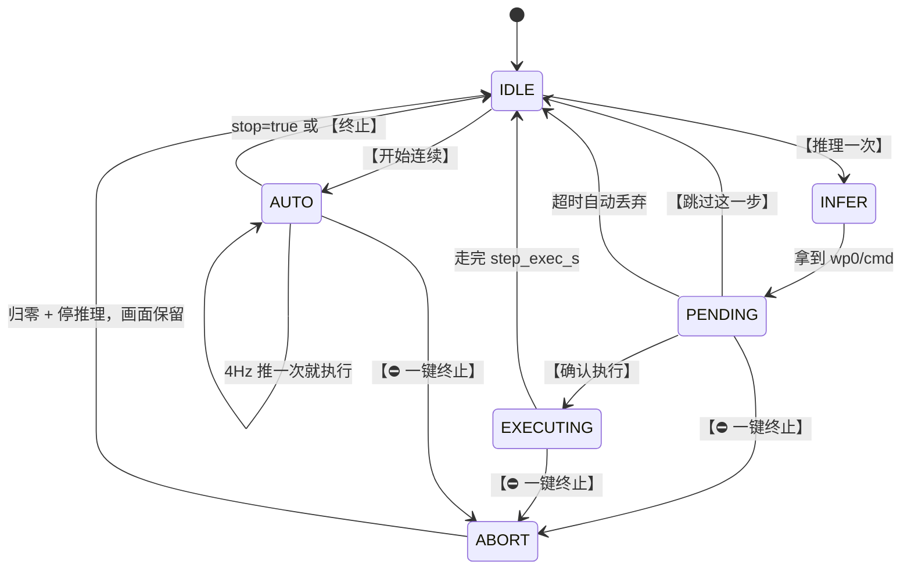

# VLN 启动指南

面向「坐在机器旁边、想尽快看到画面和预测」的场景。启动分两步，各一条命令。

> **安全默认**：不加 `--robot` 时，速度发到 `/vln/cmd_vel` —— 这个话题**没有任何节点订阅**，
> 所以桥接跑得再欢，机器人都不会动。要动必须同时满足三个条件：
> 加 `--robot` + 起 `cmdvel_to_sport` + 网页上真的点了【确认执行】/【开始连续】。
>
> **默认还是「测试 · 单步」模式**：推一帧就停下来等你确认，不点就一直是零速。
> 详见 [第 2 节](#2-两种模式)。

---

## 1. 两步启动

### 第①步：环境全部 ready

```bash
cd ~/vln
./start_vln.sh "go to the red chair"
```

依次做：**source 环境 → 起相机 → 起桥接**，等相机出图、服务端 `login/reset` 完成。

```
════════════════════════════════════════════
 ✅ 环境 ready（第①步完成）
════════════════════════════════════════════
 相机　　 : 已在跑
 机器人　 : 安全模式，没接真机
 网页　　 : 还没开（这是故意的）

 第②步：挂上网页去看画面 / 操作
   ./start_vln.sh --web
```

**这一步里没有网页，也没有授权** —— 也就是「就算推理在跑，速度也发不出去」。
这是故意的：环境（相机会话、服务端连接、图有没有来）要几十秒才能确认好，
先让它静悄悄 ready，确认没事了再开网页。

### 第②步：挂上网页

```bash
./start_vln.sh --web
```

```
🖥️  网页面板已启动
   本机    : http://127.0.0.1:8090/
   局域网  : http://192.168.128.146:8090/
```

用浏览器打开那个地址。默认是**测试 · 单步**模式：
点【推理一次】→ 看结果 → 点【确认执行】才走一小步。**不点就一直是零速。**

想摘掉网页（桥接、相机继续跑，闭环完全不受影响）：

```bash
./start_vln.sh --web-off
```

> **为什么拆两步**：网页随时能挂上摘下，坏了也只影响它自己。
> 环境起来一次要几十秒（还要重新 login/reset、等相机出图），
> 没必要为了看一眼画面把整条闭环重启一遍。

### 想省事：一次搞定

```bash
./start_vln.sh --all "go to the red chair"
```

等于上面两步连着做，起来就有网页。日常调试用这个也行。

### 常用变体

| 命令 | 用途 |
|---|---|
| `./start_vln.sh` | 用默认指令 `go to the red chair`，测试·单步，**不开网页** |
| `./start_vln.sh "go to the blue door"` | 换指令 |
| `./start_vln.sh --all` | 环境 + 网页一次到位 |
| `./start_vln.sh --web` | 只挂网页（环境已在跑） |
| `./start_vln.sh --web-off` | 只摘网页 |
| `./start_vln.sh --mode auto` | **正式 · 连续**（要在网页点【开始连续】放行） |
| `./start_vln.sh --mode auto --auto-confirm` | 正式模式 + 免放行，起来就跑 |
| `./start_vln.sh --step-exec-s 2` | 单步模式，每步走 2 秒 |
| `./start_vln.sh --no-camera` | 相机已在别处跑，只起桥接 |
| `./start_vln.sh --robot` | **真机模式**（发到 `/cmd_vel_safe`） |
| `./start_vln.sh --status` | 看现在在跑什么、网页开没开、网址是哪个 |
| `./start_vln.sh --stop` | 停掉相机和桥接 |
| `./start_vln.sh --stop --keep-camera` | 只停桥接，留着相机 |
| `./start_vln.sh -h` | 全部参数 |

### 命令行控制台

不想开浏览器（或者网页正好挂了）时用这个。它和网页共用同一套命令入口，
**网页没开的时候会自动改走桥接的本地控制通道**（`/tmp/vln_bridge.sock`），
所以它永远可用：

```bash
./tools/vln_ctl.py state      # 看状态
./tools/vln_ctl.py watch      # 每秒刷新
./tools/vln_ctl.py step       # 推理一次（会等结果出来再打印）
./tools/vln_ctl.py confirm    # 确认执行
./tools/vln_ctl.py skip       # 跳过这一步
./tools/vln_ctl.py go         # 正式模式：放行
./tools/vln_ctl.py abort      # ⛔ 一键终止
./tools/vln_ctl.py web on     # 把网页拉起来（网页崩了就用这个救）
./tools/vln_ctl.py web off    # 摘掉网页
./tools/vln_ctl.py --help
```

---

## 2. 两种模式

页面上第一行就是模式选择器，随时可切，**切换会重置本轮**：

| | ① 测试 · 单步（默认） | ② 正式 · 连续 |
|---|---|---|
| 推理触发 | 人点【推理一次】 | 自动，`--fps`（默认 4 Hz） |
| 每次推理后 | **停住**，等你看结果 | 立刻下发速度 |
| 走多远 | `--step-exec-s`（默认 1.0 s，网页滑块可调） | 一直走到下一条预测 |
| 授权 | 确认时临时授权 `step_exec_s` 秒 | 点【开始连续】后持续授权 |
| `stop=true` | 不执行，交给人决定 | 停下并结束本轮 |
| 什么时候用 | 调参、验证、第一次跑 | 正式跑任务 |



> 测试模式**仍然是一个 episode**（`login`/`reset` 建的是有记忆的会话）。
> 「单步」是「在同一个会话里一次推一帧」，不是「每步重连一次」。

### 测试模式的一步是怎么走的

1. 点 **【① 推理一次】** → 抓当前画面推一次，结果挂成「待确认」
   - 此刻速度**仍然是零**，画面中央出现浮层显示 `vx / vy / wz` 和倒计时
2. 看浮层和右侧的模型输出，然后三选一：
   - **【② 确认执行】** → 按当前时长走一小步，走完自动归零
   - **【跳过】** → 丢弃这一步，回到待命
   - **什么都不点** → `--pending-timeout-s`（默认 60 s）后自动丢弃，**不会执行**
3. 回到第 1 步，重复。

日志长这样：

```
[16:55:12] seq=  3  rtt= 181.6ms  wp0=[+0.148 +0.022 +0.204]  cmd=(vx+0.197 vy+0.000 wz+0.800)  stop=False vis=False  → 待确认
[16:55:15] ✅ 已授权执行（1.5 s 后自动收回）
[16:55:15] ✅ 执行第 1 步：1.50 s × (vx+0.197 vy+0.000 wz+0.800)
```

### 单步走多远

**真正走的距离 = 单步时长 × 模型给的速度**。日志里会算一遍给你看：

```
⚙️ 单步执行时长 → 1.50 s（约 75 cm/步）    # 75cm 是按 max_vx=0.5 m/s 估的上限
```

实际上模型这次只给了 `vx=0.197`，所以 1.5 s 大约走 **30 cm**。
要更细粒度就把滑块调小（最小 0.2 s）。

### 正式模式的放行闸

`--mode auto` 默认**不会一启动就冲出去**：推理线程会停在 `phase=wait_go`，
直到你在网页点【开始连续】。这是为了防止误切模式导致机器突然动起来。

想省掉这一步：`./start_vln.sh --mode auto --auto-confirm`

### ⛔ 一键终止

**任何时候、任何模式、任何阶段都能点**（快捷键 `Esc`）。它会：

1. 立刻把 `/cmd_vel` 置零，并连发 3 帧零速（不等下一个定时器周期）
2. 收回授权
3. 停掉推理线程，唤醒所有等待中的人工确认
4. **画面继续实时刷新**（预览是独立线程），只是不再推理

日志：

```
[16:55:41] ⛔ 一键终止：归零 + 停止一切推理与下发
[16:55:41] 🛑 急停！收回授权并结束本轮
[16:55:42] 连发 10 帧零速 …
```

终止后状态是 `aborted=true / phase=ended`，点【重新开始本轮】即可继续。

> 【暂停】和【一键终止】的区别：**暂停**只收回授权，推理继续跑（速度为零但一直在看画面）；
> **一键终止**连推理一起停。

---

## 3. 网页上有什么

```
┌──────────────────────────────────┬─────────────────┐
│  实时预览（独立线程，5 Hz）        │  推理结果        │
│  模型真正输入的那一帧叠在上面      │   seq / step    │
│  VX / VY / WZ 叠加                │   航点 wp0      │
│  状态角标（待命/待确认/执行中…）   │   rtt / 服务端耗时│
│                                  │   stop / visible │
│  〔待确认浮层〕                   │   pointing       │
│  vx 0.197  vy 0.000  wz 0.800    ├─────────────────┤
│  47 s 后自动丢弃                  │  运行状态        │
│  ┌────────────────────────────┐  │  授标/计数/线程    │
│  │ ① 测试·单步  ② 正式·连续     │  ├─────────────────┤
│  │ 单步时长 ━━━●━━━  1.0 s      │  │  最近预测（滚动） │
│  │ ① 推理一次  ② 确认执行  跳过  │  │                 │
│  │ ⛔ 一键终止（停推理 + 归零）  │  │                 │
│  │ [指令输入框] [应用并重置]     │  │                 │
│  │ 【重新开始本轮】            │  │                 │
│  └────────────────────────────┘  │                 │
└──────────────────────────────────┴─────────────────┘
```

### 按钮

| 按钮 | 快捷键 | 可用条件 | 做什么 |
|---|---|---|---|
| ① 测试 · 单步 | | 总是 | 切到单步模式（重置本轮） |
| ② 正式 · 连续 | | 总是 | 切到连续模式（重置本轮） |
| 单步时长（滑块） | | 单步模式 | 0.2–5 s，松手即生效 |
| ① 推理一次 | `E` | 单步模式、无待确认 | 推一帧，结果挂成待确认 |
| ② 确认执行 | `空格` | 有待确认 | 走这一小步 |
| 跳过 | `S` | 有待确认 | 丢弃待确认的这一步 |
| 开始连续 | `E` | 连续模式、未放行 | 放行，开始连续推理与下发 |
| 暂停 | `空格` | 已授权 | 收回授权（推理继续） |
| ⛔ 一键终止 | `Esc` | **总是** | 停推理 + 归零 |
| 重新开始本轮 | | 本轮已结束 | 用当前指令重开 |
| 应用并重置 | | — | 改指令并重开 |

### 画面不再跟随推理

**预览是独立线程（`--preview-hz`，默认 5 Hz）**，只要桥接活着就一直在刷新，
和推理的状态无关。所以你：

- 在待确认时盯着画面看 —— 它是**活的**，能看出场景有没有变
- 点【一键终止】之后画面**仍然在动**（只是不再推理）

判断「画面卡住了」的正确姿势：看状态里的 `image_age_s`（最新帧距今多久）。
正常在 0.05 s 以内；超过 1 s 才是真卡住了。

```bash
./tools/vln_ctl.py state | grep 计数
#   计数 图 3542  推理 3  下发 2568  零速 2568   图龄 0.057s
```

> 旧版本里「本轮结束画面就定格」是因为画面只能由推理线程喂。
> 现在两者解耦了，定格提示还在（告诉你推理停了），但画面不会冻。

### 网页是运行期挂载的

没挂网页的时候，预览线程**完全不干活**（不抓图、不缩图、不编码），CPU 占用为零。
你 `./start_vln.sh --web` 挂上之后，最多 `1 / --preview-hz` 秒（默认 0.2 s）
画面就出来 —— 因为桥接一直在收图，预览只是「要不要编码」的问题。

反过来，`./start_vln.sh --web-off` 摘掉网页之后，推理、下发、闭环全都照常跑，
只是没人在看。再 `--web` 挂回来即可。

### 网页和命令行是同一套入口

页面上每个按钮背后都是桥接的 `dispatch(cmd, body)`，命令行 `vln_ctl.py` 走的是同一个函数
（网页走 HTTP，命令行优先走 HTTP、网页没开时自动改走 unix socket）。
所以两边**永远一致**，不存在「网页能点、命令行不行」这种情况。

---

## 4. 手动分步启动（`start_vln.sh` 出问题时的对照）

脚本只是把下面四步串起来了。要精确控制就走这条路径。

### 第 0 步：环境

```bash
cd ~/vln
source ./setup_vln_ros2.sh      # 必须 source，不能 ./ 执行
```

打印出来的三行是后续命令的基础：

```
ROS_DISTRO      : jazzy
RMW             : rmw_fastrtps_cpp
VLN_PY          : /home/unitree/vln_env/bin/python
```

> ⚠️ **默认 python3 不能用**。本机 `python3` 是 miniconda 的 3.14，而 ROS 2 Jazzy 和
> `pyrealsense2` 都是按 3.12 编的。**一律用 `$VLN_PY`。**

### 第 1 步：相机

```bash
ros2 launch realsense2_camera rs_launch.py \
  camera_namespace:=camera camera_name:=camera \
  serial_no:="'347622073141'" \
  enable_color:=true enable_depth:=true \
  pointcloud.enable:=false publish_tf:=false \
  rgb_camera.color_profile:=640x480x30
```

**`pointcloud.enable:=false` 不能省。** 当前的 `realsense2_camera` 不认识同事 config 里的
`pointcloud__neon_.enable`，点云会退化成 CPU 计算，把整个相机节点拖到 0.8~3.4 fps。

另开一个终端验证：

```bash
source ~/vln/setup_vln_ros2.sh
ros2 topic hz /camera/camera/color/image_raw
# average rate: 29.0 左右就对了
```

### 第 2 步：桥接（先不开网页）

```bash
cd ~/vln
$VLN_PY vln_ros2_bridge.py \
  --instruction "go to the red chair" \
  --publish \
  --encode-width 640 \
  --ctl-socket /tmp/vln_bridge.sock
```

`--publish` 是允许发速度（但话题默认是安全的 `/vln/cmd_vel`）；
`--encode-width 640` 缩图，把服务端耗时从约 289 ms 降到约 190 ms；
`--ctl-socket` 开本地控制通道，**网页没起来时靠它操作节点、也靠它把网页拉起来**。

想先纯观察、完全不发速度，把 `--publish` 去掉即可。

日志里应该能看到：

```
[17:11:15] ℹ️ 测试模式，但网页还没开 —— 不会自己动。
[17:11:15] 控制通道 : /tmp/vln_bridge.sock（unix socket，用于网页启停 / 命令行操作）
[17:11:15] 网页面板 : ⬜ 还没开（环境先 ready，这一步是故意的）
```

这个状态下 `./tools/vln_ctl.py step` 就能推帧、`confirm` 就能执行 —— 不需要网页。

### 第 3 步：开网页

从命令行把网页挂到**正在跑**的桥接上（不用重启）：

```bash
./tools/vln_ctl.py web on      # 或者： ./start_vln.sh --web
```

浏览器打开 `http://127.0.0.1:8090/`（脚本会自动探测实际端口）。

想摘掉：`./tools/vln_ctl.py web off`（或 `./start_vln.sh --web-off`）。
摘掉之后桥接和推理完全不受影响，再 `web on` 又能挂回来。

> 网页是**运行期**挂载的，所以桥接进程里 `--web` 不是必须的 ——
> 想启动时就带上也行，那等于 `./start_vln.sh --all` 的效果。

---

## 5. 真机模式（会让机器人动，谨慎）

### 先小步试链路：`tools/sport_test.sh`

**强烈建议第一次接真机时先跑这个**，它是分级的人工测试工具，
每一步都问你要不要继续，速率也钳得很小（|vx|≤1.0 m/s）：

```bash
./tools/sport_test.sh probe        # 只读：看话题/节点/进程在不在，不发任何消息
./tools/sport_test.sh up           # 起 cmdvel_to_sport
./tools/sport_test.sh link         # 发一帧零速，验证指令能到机器人（不会动）
./tools/sport_test.sh go 0.20      # 真走：前进 20 cm/s，duration 秒后自动停
./tools/sport_test.sh stop         # 归零（应急直接 Ctrl-C，duration 到期会自停）
./tools/sport_test.sh down         # 停 cmdvel_to_sport
```

判读关键在 `link` 的日志 —— `cmdvel_to_sport` 是**唯一**会告诉你「指令被接受没有」的地方：

| 日志 | 含义 |
|---|---|
| `SetVelocity response: id=7105 code=0` | 链路全通，可以 `go` 了 |
| `SetVelocity response: id=7105 code=<非0>` | 消息到了机器人，但运动服务拒绝了 |
| `SetVelocity failed: N` | 连不上机器人的运动服务 |
| **什么都没有** | 消息根本没到（话题名不对 / 节点没起） |

### 然后在网页上跑

```bash
./start_vln.sh --robot "go to the red chair"
./start_vln.sh --web
```

跟安全模式的差别只有两处：

1. 桥接改成 `--cmd-vel-topic /cmd_vel_safe`
2. 额外起一个 `cmdvel_to_sport`：

```bash
ros2 run g1_nav_bridge cmdvel_to_sport --ros-args \
  -p cmd_vel_topic:=/cmd_vel_safe -p duration:=0.5
```

### 为什么必须走 `/cmd_vel_safe`

完整链路是：

```
Nav2 → /cmd_vel_nav → velocity_smoother → /cmd_vel → collision_monitor
     → /cmd_vel_safe → cmdvel_to_sport → G1LocoClient → /api/sport/request → G1
```

**直接发 `/cmd_vel` 会绕过 `collision_monitor`**（碰撞监控），危险。

### `cmdvel_to_sport` 没有看门狗

它只缓存最新一条 Twist，在工作线程里调 `SetVelocity(vx, vy, wz, duration)`。
**唯一的自停机制就是那个 `duration`（0.5 s）。**

所以下发频率必须 **大于 `1 / duration` = 2 Hz**，否则 0.5 秒一过就自停，表现为**走走停停**。
桥接的控制定时器默认 20 Hz，远高于此 —— 但前提是 `rtt` 别超 `--cmd-timeout`（0.6 s）。
日志里如果出现 `往返 P95 … 已接近/超过 cmd_timeout`，就降分辨率或放宽超时。

---

## 6. 排错

先看日志：

```bash
./start_vln.sh --status
tail -f ~/vln/logs/bridge.log
```

### 网页打不开 / 连不上

先分清是「没挂」还是「挂了但不通」：

```bash
./start_vln.sh --status                   # 一看便知：网页 开/关、端口多少
./tools/vln_ctl.py web                    # 同一个信息，走 socket，不依赖网页
ss -ltn | grep 8090                       # 有没有监听
curl -s http://127.0.0.1:8090/api/state   # 有没有响应
```

- **显示「网页 关」** → 就是没挂，挂上即可：`./start_vln.sh --web`
  （网页崩了也一样：再 `--web` 一次就重新起来）
- **端口被占**：会自动往后试 12 个，实际端口看 `--status` 或 `cat /tmp/vln_web_port`
- **状态显示「开」但浏览器连不上** → 确认 `--web-host` 是 `0.0.0.0`（脚本默认就是），
  以及防火墙没拦。局域网访问用 `--status` 里那个 `192.168.x.x` 地址。
- **`--web` 报「连不上桥接的控制通道」** → 桥接是旧版本（还没有 `--ctl-socket`）。
  `./start_vln.sh --stop && ./start_vln.sh` 重启一下即可。

### 画面是黑的 / 一直是「等待图像 …」

```bash
ros2 topic hz /camera/camera/color/image_raw
```

- **有 30 fps，但网页没图** → 看 `logs/bridge.log` 和 `image_age_s`。
  如果 `worker_alive=False` 但画面还在动，那是正常的（预览与推理解耦）；
  真没图的话先看 `preview_hz` 是不是被设成 0 了。
  是的话点【重新开始本轮】即可，不是故障。
- **帧率在 0~5 之间反复** → 走到了相机僵死。先 `./start_vln.sh --stop` 全停再重来。
  若仍然僵死，看下面「RMW」那条。
- **完全没有这个话题** → 相机没起来。看 `logs/camera.log`：
  - `Device or resource busy` → 相机被别的进程占用，先 `./start_vln.sh --stop`
  - 一堆 `pointcloud__neon_.enable ... is not supported` 警告 → 有人没关点云

### RMW 不一致（最容易踩）

**相机和桥接必须用同一个 RMW。** RMW 不同 = 不同的发现域，双方互相完全看不到 topic，
现象就是「进程都在跑，就是没图」。

`setup_vln_ros2.sh` 默认 `rmw_fastrtps_cpp`。**不要**单独用 `VLN_RMW=rmw_cyclonedds_cpp`
起相机再起桥接，那是两个域。脚本把两者放在同一个 shell 里起，就是为了避免这件事。

> 为什么默认不用 CycloneDDS：宇树那份 `CYCLONEDDS_URI` 把接口钉死在 `enP2p1s0`
> （没有回环/共享内存），而同机传 640x480 RGB8（≈900 KB × 30 fps ≈ 27 MB/s）的图像
> 又是 `RELIABLE + KEEP_LAST(1)`，写入端会被 ACK 堵死，
> **导致 `realsense2_camera` 逐渐僵死**（30 → 11 → 0 fps，重启只能撑十几秒）。
> 换 `rmw_fastrtps_cpp` 后稳定 23~30 fps。
>
> 所以脚本默认 fastrtps。要切回（比如必须和 G1 其他节点同域）：
> `VLN_RMW=rmw_cyclonedds_cpp ./start_vln.sh` —— 但那会重新引入掉帧，务必降到 640 或更低。

### 页面「未授权」是什么意思

不是网络权限、不是报错，是**你自己那个批准闸门的状态**：

| 显示 | 含义 | 实际下发 |
|---|---|---|
| 待命 | `armed=False`，单步模式等着你点【推理一次】 | 每一拍都是 `(0,0,0)` |
| 推理中… | `phase=inferring` | 仍然是零速 |
| 待确认 | `phase=pending`，有一步挂在那里等你 | **仍然是零速**（关键就在这里） |
| 执行中 | `phase=executing`，走这一小步 | 发真实速度，到点自动收回 |
| 连续执行中 | 正式模式已放行 | 发到你点【暂停】或【一键终止】 |
| 待放行 | `phase=wait_go`，正式模式等人放行 | 零速 |
| 已终止 | 点了【⛔ 一键终止】 | 零速，推理也停了 |

> **环境 ready、网页还没挂的那个状态**，就是「未授权」这一行：
> 推理线程在待命，控制节拍每拍都发 `(0,0,0)`，比网页在的时候只多不少地安全。

判断有没有真的发出去，看这两个计数（差值就是真实速度帧数）：

```bash
./tools/vln_ctl.py state | grep 计数
#   计数 图 3542  推理 3  下发 2568  零速 2568   图龄 0.057s
#   下发 == 零速 → 至今 100% 都是零速
```

### 用 curl 点按钮时没反应

`/api/*` 只认 JSON，不加 header 会被忽略：

```bash
# ✅ 测试模式：推理一次
curl -X POST -H 'Content-Type: application/json' -d '{}' \
  http://127.0.0.1:8090/api/step

# ✅ 正式模式：放行
curl -X POST -H 'Content-Type: application/json' -d '{}' \
  http://127.0.0.1:8090/api/start_auto

# ❌ form-encoded，请求会被当成空 body
curl -X POST -d '{}' http://127.0.0.1:8090/api/step
```

懒的话直接用命令行工具，它已经把 header 和状态解析都包好了：

```bash
./tools/vln_ctl.py step && ./tools/vln_ctl.py confirm 1.5
```

> 所有 POST 的返回都是 `{"ok":..., "state": {...}}`（比 `GET /api/state` 多包一层）；
> GET 直接返回 `{...}`。写脚本时注意。

### 手动 `ros2 topic pub` 发速度没反应 / 一直卡住

**症状 A** —— 命令一直刷这两行，永不结束，`--times 20` 一条也没发出去：

```
Waiting for at least 1 matching subscription(s)...
Waiting for at least 1 matching subscription(s)...
```

原因：`ros2 topic pub` 的 **`-w/--wait-matching-subscriptions` 默认是 1**，
它在等「至少 1 个订阅者」。而 `/cmd_vel` 的订阅者是 `collision_monitor`，
**现在没跑**，所以 `/cmd_vel` 订阅数为 0 → 永久阻塞。

**症状 B** —— 加了 `-w 0` 之后命令立刻「成功」，但机器人纹丝不动。
那是因为消息发进了虚空，**不代表链路通了**。

先确认订阅者到底有没有：

```bash
ros2 topic info /cmd_vel        # 期望 Subscription count >= 1
ros2 topic info /cmd_vel_safe   # 得先起 cmdvel_to_sport 才有这个话题
```

| 话题 | 谁在听 | 说明 |
|---|---|---|
| `/cmd_vel_nav` | `velocity_smoother` | Nav2 内部，别手动发 |
| `/cmd_vel` | `collision_monitor` | 它没跑就是 0 订阅者 |
| `/cmd_vel_safe` | **`cmdvel_to_sport`** | ✅ **手动发速度应该用这个** |
| `/cmd_vel_teleop` | `behavior_server` | Nav2 恢复行为自用，不通机器人 |

正确的两条路，见 [第 5 节](#5-真机模式会让机器人动谨慎)：

```bash
# ① 用工具（推荐，会先检查订阅者，避免白测）
./tools/sport_test.sh up && ./tools/sport_test.sh link && ./tools/sport_test.sh go 0.20

# ② 手写
ros2 run g1_nav_bridge cmdvel_to_sport --ros-args \
  -p cmd_vel_topic:=/cmd_vel_safe -p duration:=0.5
ros2 topic pub --times 20 -r 10 /cmd_vel_safe geometry_msgs/msg/Twist \
  '{linear: {x: 0.3}, angular: {z: 0.0}}'
```

判读只认 `cmdvel_to_sport` 的日志 `SetVelocity response: id=7105 code=0`。

---

## 7. 已知的坑：相机装反了

当前 D435i 是**俯视**装的，而同事的服务端按**前视**标定：

```
--cam_hfov_deg 90 --cam_height 0.6
```

（见 `README_CN.md`：这两个值不通过命令行传，是服务端启动时写进 manifest 的，
**换机器人时一定要改**，否则轨迹带画的位置会偏 —— 它们决定「预测的前方 0.375 m 落在画面哪一行」。）

而 D435i 彩色 **HFOV 约 69°**，和 90° 也不一致。所以：

1. 把相机调成**前视**，抬高到大约离地 0.6 m
2. 找同事确认 `--cam_hfov_deg` / `--cam_height` 该填多少

订阅本身没问题（`/camera/camera/color/image_raw` 是系统里唯一的活图像话题，
`frame_id` 是标准的 `camera_color_optical_frame`，转换代码无翻转无旋转）。
G1 自带头部相机走的是 **WebRTC**，不是 ROS Image 话题，取不到。

---

## 8. 相关文件

| 文件 | 说明 |
|---|---|
| `start_vln.sh` | 启动/停止/网页开关（本文档对应的脚本） |
| `tools/vln_ctl.py` | 网页按钮的命令行版，调试/自动化用；网页没开时自动走 socket |
| `tools/sport_test.sh` | 真机链路分级测试（probe / up / link / go …），见 [第 5 节](#5-真机模式会让机器人动谨慎) |
| `setup_vln_ros2.sh` | 环境准备，必须 `source` |
| `vln_ros2_bridge.py` | 桥接节点主体（含测试/正式模式的状态机、控制通道） |
| `vln_web_ui.py` | 网页控制台（纯标准库） |
| `vln_robot_client.py` | 离线客户端（`VelocityCmd` / `encode_jpeg_b64` / `waypoint_to_velocity`） |
| `ROS2_BRIDGE.md` | 更详细的桥接设计、性能数据、排错 |
| `logs/bridge.log` | 桥接日志，出问题先看它 |
| `logs/camera.log` | 相机日志 |
